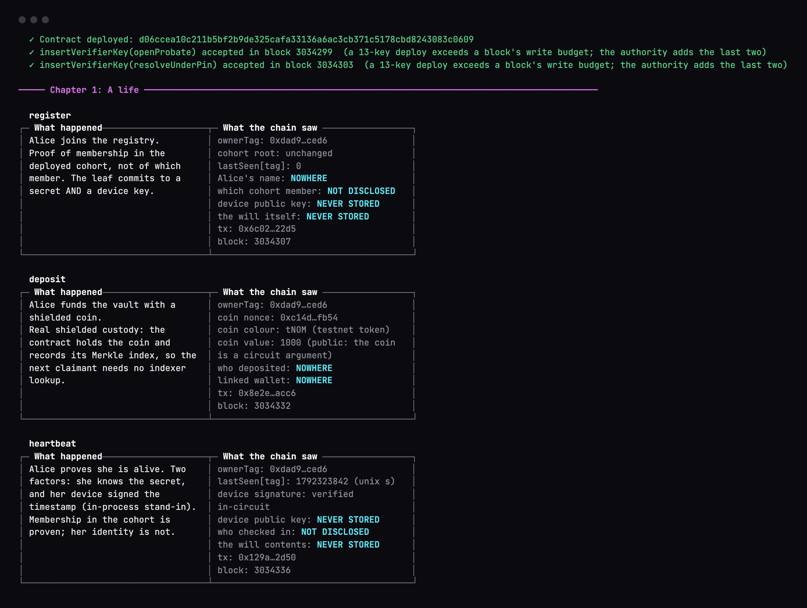
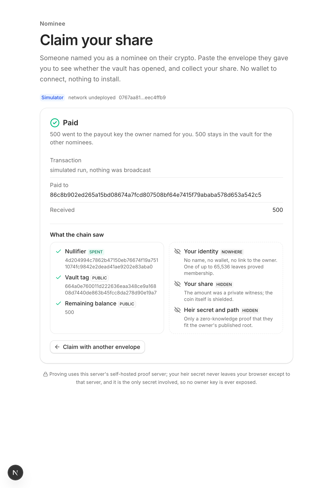
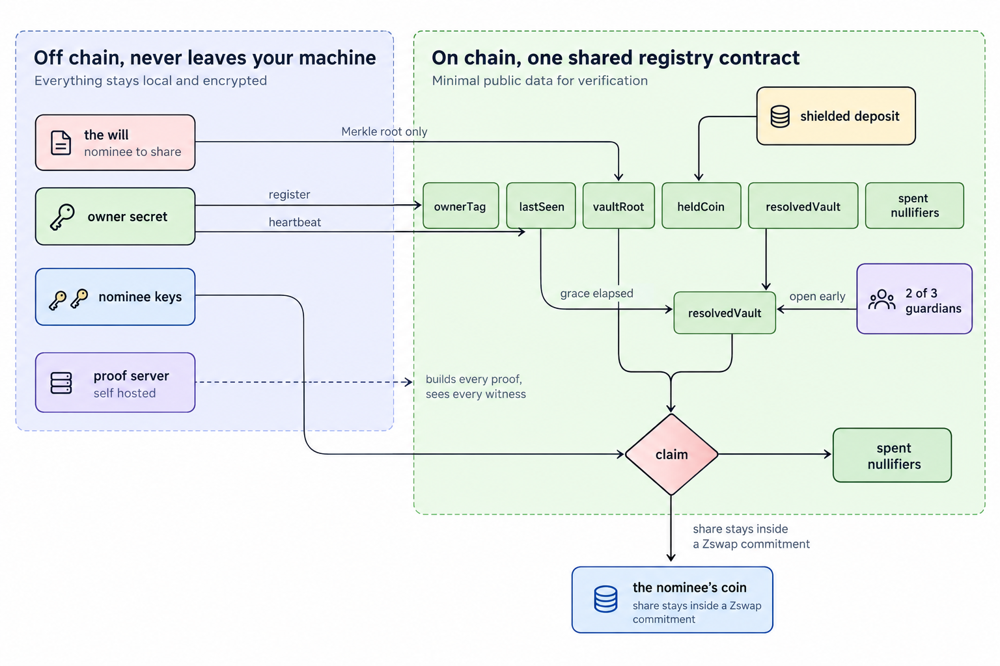
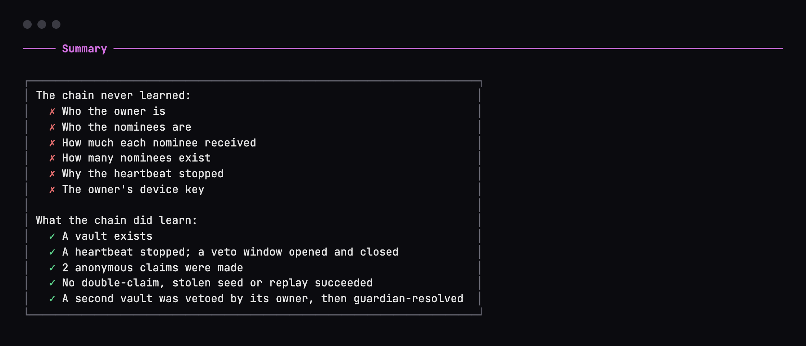
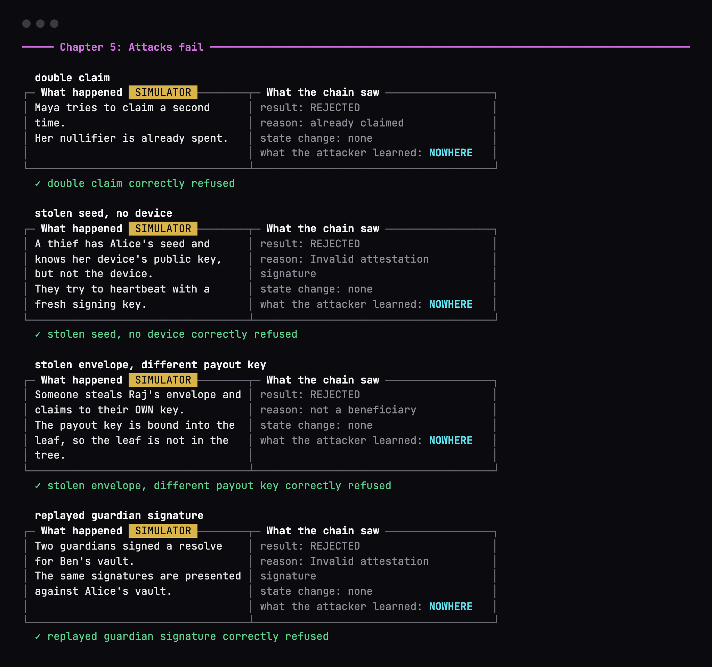

# Nominee
### Add a nominee to your crypto. Nobody learns who.
nominee.world · built on Midnight

---

**$68.7 billion in Bitcoin is permanently lost.** Much of it belonged to people who died. Their families got nothing, not because the money was stolen, but because every existing solution forces a choice: reveal your nominees to a company, expose them on a public chain, or accept that your crypto dies with you.

**Nominee** is a private, self-executing nominee registry on Midnight. You deposit assets, name your nominees, and check in with a periodic heartbeat. If the heartbeats stop, the vault opens and each nominee claims their share, paid by the contract itself. Nobody, ever, learns who they are.

**Your crypto knows who comes next. Nobody else does.**

[Demo video](https://youtu.be/Fb69qNrujFU) · [Deck](docs/nominee-deck.pdf) · [nominee.world](https://nominee.world)



Every step of the demo prints two panels. What actually happened on the left,
what the chain got out of it on the right.

---

## Why Midnight

| | Reveals the beneficiary | Trusts a company |
|---|---|---|
| Sarcophagus | Yes, recipient address, resurrection time, every check-in | No |
| Bitcoin timelock / miniscript | Yes, at spend: script policy, timelock, heir pubkey | No |
| Casa Inheritance | No | **Yes** |
| Inheriti | No | **Yes** |
| Coinbase | Yes, to the company and the court | **Yes** |
| **Nominee** | **No** | **No** |

Every *trustless* option reveals the beneficiary, at setup, or at execution. Every option that hides the beneficiary trusts a company. Nominee is the only design where the beneficiary set, the per-nominee shares and the conditions are never public while execution stays trustless and on-chain.

That is only possible because of two Midnight properties together: a **shielded pool** that hides value, and a **compiler that statically proves** a private value never reaches public state.

## Run it

You need [Docker](https://docs.docker.com/desktop/) running and
[Bun](https://bun.sh). You do **not** need the Compact toolchain, the compiled
circuits and proving keys in `contract/out/` are committed.

```bash
git clone https://github.com/vwakesahu/nominee && cd nominee
bun install                   # always from the repo root, see the gotcha below
./run-devnet.sh               # brings up the devnet and runs the demo on chain
```

`run-devnet.sh` starts Docker Desktop if it is not up, brings up the node,
indexer and proof server, builds the CLI and runs the demo live. First run pulls
images and takes a few minutes. After that it is about six.

To run the pieces separately:

```bash
docker compose up -d            # node, indexer, proof server
bun run --cwd cli build
node cli/dist/index.js demo     # simulator, fast, no chain
NOMINEE_LIVE=1 node cli/dist/index.js demo   # real proofs on the devnet
```

Tests and checks:

```bash
bun run test        # 49 simulator tests
bun run leakcheck   # ZKIR privacy scan, checks no secret reaches public state
bun run nominee doctor
```

The demo runs six chapters: a life (register, deposit, heartbeat, update the
will, heartbeat), silence, resolution (a veto window opens, then `finalize`),
the nominees claiming, six attacks refused, and a faked death that the owner
contests. With `NOMINEE_LIVE=1` everything except the refusals runs on the
devnet, including the three shielded payouts. Refusals happen at circuit
execution before a proof exists, so they run in the simulator and say so.

### The device

The heartbeat and the will update both need two factors: the owner secret, and
a Schnorr signature from the owner's device over the timestamp. `nominee device`
is a stand-in signer:

```bash
node cli/dist/index.js device --pulse          # http://127.0.0.1:7777
NOMINEE_DEVICE_URL=http://127.0.0.1:7777 NOMINEE_LIVE=1 node cli/dist/index.js demo
```

It exposes `GET /pubkey` and `POST /sign {kind, now}` (kind 2 signs a heartbeat,
kind 4 a will update), and refuses to sign (409) without `--pulse`. An ESP32
with a pulse sensor implements the same two calls.
Without `NOMINEE_DEVICE_URL` the demo signs in-process.

### Claim as an heir

A nominee does not need the CLI, or a wallet. The owner gives each nominee an
envelope (a small JSON file, written to `deployments/envelopes/<name>.json` by
the demo, gitignored because it holds the nominee's secret). The nominee pastes
it into a web page.

```bash
bun run server      # API on http://127.0.0.1:8787, simulator mode
bun run web         # Next.js page on http://localhost:3000
```

Against the devnet: `NOMINEE_LIVE=1 NOMINEE_CONTRACT=<address> bun run server`.
To leave one nominee's share unclaimed by the demo so the page can claim it,
run the demo with `NOMINEE_HOLD_HEIR=sam`.



The page shows the vault's state in one sentence (still in the grace period,
still in the veto window, open), then claims. The payout goes to the key the
owner bound into the nominee's leaf, so there is no wallet to connect and a
stolen envelope still pays the nominee the owner named. Proving runs on the
server's self-hosted proof server; the only witnesses a nominee ever sends are
their own secret, share and Merkle path.

### On chain

A recorded live run is in [`deployments/devnet.json`](deployments/devnet.json):
**17 accepted transactions** on contract `5da98e56…e5cc67`. Deploy, two
verifier-key inserts, register, deposit, two device-signed heartbeats, a
device-signed `updateWill`, `resolve`, `finalize`, three `claim`s (`heldCoin`
1000 → 500 → 200 → entry removed), a second owner's register, `resolve`,
`veto`, and `guardianResolve2of3`. Plus one deliberately refused `finalize`
after the veto (`no open challenge`). Nothing in the run is simulator-only.

Two of the claims came from the CLI (blocks 659 and 663). The third came from
the heir web page: the run held Sam back with `NOMINEE_HOLD_HEIR=sam`, then
Sam's envelope was pasted into the claim server, which proved and submitted
the claim in block 681.

**On Preprod.** The same story ran on the public Preprod network, recorded in
[`deployments/preprod.json`](deployments/preprod.json): **19 accepted
transactions** on contract `f3989203…7f1247`, blocks 3,023,384 to 3,023,703.
That covers deploy, register, a deposit, device-signed heartbeats and will
update, `resolve`, `finalize`, three claims, the faked-death veto and the
guardian path. Two claims came from the CLI. Sam's came from the heir web page
in block 3,023,703. Anyone can look up any hash on the Preprod indexer.

One difference from the devnet. The funded Preprod wallet holds unshielded
NIGHT, and NIGHT cannot be shielded, so the vault there holds **tNOM**. tNOM is
a testnet-only shielded token from [`contract/token`](contract/token) that
mints to the wallet. Nominee's `deposit` and `claim` accept a coin of any
colour, so the vault contract is identical.

To reproduce it, you need a funded, DUST-registered Preprod wallet and a
Blockfrost project id for Midnight Preprod. Midnight shut its own Preprod
indexer on 9 October 2026, and Blockfrost now serves Preprod. Use Node 22.

```bash
NOMINEE_NETWORK=preprod NOMINEE_LIVE=1 \
NOMINEE_BLOCKFROST=<project id> NOMINEE_MNEMONIC="<24 words>" \
fnm exec --using=22 node cli/dist/index.js demo
```

The first run scans about 1.7 million DUST events, which takes about 30
minutes with the machine awake. It checkpoints to `~/.nominee/`, so later runs
start in seconds.

## Architecture

One **shared registry contract** serves many owners, a contract per will would turn every heartbeat into a per-person fingerprint.



Every arrow crossing into the contract carries a hash, a root or a proof. The
will, the identities and the individual shares never make that crossing.

A vault opens in two steps. After the grace period anyone may call `resolve`,
which opens a veto window (30 s in the demo, weeks when shipped). The owner
closes it with a heartbeat or, if the device is lost, with `veto` using the
secret alone. Two of three guardians can close it too. Only if nobody does can
anyone call `finalize`, and only then can nominees claim. Death is never
asserted, only absence, and absence can be contested.

| circuit | k | rows | |
|---|---:|---:|---|
| `register` | 14 | 15,678 | join the registry; leaf binds secret, will root and device key |
| `heartbeat` | 15 | 17,266 | proof of life, secret plus device signature; closes a window |
| `veto` | 14 | 15,751 | secret only; closes a window |
| `deposit` | 15 | 16,803 | shielded coin in; `insertCoin` records its Merkle index |
| `updateWill` | 15 | 17,310 | replace the beneficiary root; secret plus device signature |
| `resolve` | 10 | 511 | permissionless after grace; opens the veto window |
| `finalize` | 9 | 379 | permissionless after the window; unlocks the vault |
| `guardianResolve2of3` | 12 | 3,356 | guardians open early; message bound to the vault tag |
| `guardianResolve3of5` | 13 | 4,876 | " |
| `guardianVeto2of3` | 12 | 3,358 | guardians contest a window |
| `claim` | 16 | 37,866 | nominee claims a private share to the key bound in their leaf |
| `openProbate` | 14 | 11,270 | scoped disclosure to a court |
| `resolveUnderPin` | 13 | 7,290 | duress decoy |
| **13 circuits** | **max k=16** | **151,714** | 75 MB proving keys |

Full detail (state layout, per-circuit inputs, envelope format, threat model) is in [`docs/ARCHITECTURE.md`](docs/ARCHITECTURE.md).

## What the chain learns




**Never:**
- Who the owner is
- Who the nominees are
- How much each nominee received
- How many nominees exist
- Why the heartbeat stopped
- The owner's device key

**Does:**
- A vault exists
- A heartbeat stopped
- A window opened, and whether it was contested
- N anonymous claims were made
- No double-claim succeeded

### Attacks, run every time the demo runs



Six refusals: a nominee claiming twice, a stranger, a nominee asking for more
than they were left, a stolen seed heartbeating without the device, a stolen
envelope claiming to a different payout key, and a guardian signature for one
vault replayed against another.

## The judge's five questions

**How do you prove a heart rate is the owner's?** You cannot, and the circuit
does not try. A circuit verifies a signature, never a pulse. What it verifies is
that the owner's registered device signed this timestamp, and the device is
built to sign only while it reads a pulse. That raises the cost of faking
liveness from "copy a seed" to "hold the device and keep it on a living body".
It does not make faking impossible.

**Does proof of life come from hardware?** Half of it. The heartbeat needs the
owner secret and a Schnorr signature from a device key whose commitment sits in
the owner's leaf. The device key never reaches the chain. The repo ships a
stand-in signer (`nominee device`) with the same two HTTP calls an ESP32 with a
pulse sensor would expose; the hardware itself is not built.

**How do you prevent identity theft?** A stolen seed cannot heartbeat without
the device. On the resolution path the most it can do is `veto`, which delays
inheritance and never redirects it. A stolen envelope pays the nominee the
owner named, because the payout key is bound into the nominee's leaf.
`updateWill` needs the device too, so a seed thief cannot rewrite who the vault
pays. Two limits: someone holding both the seed and the device is the owner as
far as the chain can tell, and losing the device freezes the will until a new
registry is deployed with a new device commitment.

**How do you prevent faking death?** Death is never asserted. `resolve` only
opens a veto window; the owner closes it with a heartbeat, or with the secret
alone, and two of three guardians can close it too. `finalize` succeeds only if
nobody objected for the whole window. The limit is the window length: a long
hospital stay with no device, no seed access and inattentive guardians still
executes the will.

**Heirs needing a wallet will break adoption.** They do not need one to claim.
The owner fixes each nominee's payout key when writing the will, and the
nominee pastes an envelope into a web page. The limit: the nominee needs a
Midnight key for the owner to bind, and to spend what arrives they will need a
wallet that holds it. The claim step itself asks for nothing.

## Honest limits

Named here because a judge will find them anyway, and because the validation found them first.

- **The proof server sees every witness. Self-host it, always.** This also rules out `getProvingProvider()` in the DApp Connector, which delegates proving to the wallet. The rule is strict for owners, whose witnesses are the will, and relaxed for heirs, whose witnesses are only their own secret, share and path. That is why the heir page may prove on the server's prover and the owner CLI must not.
- **The device raises the cost of faking liveness. It does not make it impossible.** A circuit verifies a signature, never a pulse.
- **Deposit amounts are public**, the coin is a circuit argument, and circuit arguments are public.
- **The remaining balance is public** in `heldCoin`, so the outstanding total is observable even though individual shares are not.
- **Heartbeat cadence is a timing fingerprint.** The shared registry blunts it, an observer sees *someone* checked in, but it does not erase it.
- **A long hospital stay executes the will.** The veto window and guardians lengthen the fuse. They do not remove it.
- **A deploy with all 13 verifier keys does not fit in one block** on node 1.0.0. The deploy omits two keys and the maintenance authority inserts them in two follow-up transactions. See ARCHITECTURE §9.
- **On Preprod the vault holds a testnet token, not NIGHT.** NIGHT is unshielded and cannot be shielded, so the Preprod run deposits tNOM. The vault contract is the same; a mainnet vault would hold a shielded asset.
- **Lace has no plugin mechanism**, Nominee is its own DApp that wallets connect to, not a wallet feature.
- **Legally this is a transfer mechanism, not a will.** Lead with the probate-disclosure feature, not the privacy feature.

## Two gotchas worth knowing

**Always install from the repo root.** Installing inside a workspace creates a
second copy of the wasm bindings there, which reproduces the class-identity
failure below. The root `overrides` pin only applies to a root install.

Bun is the package manager. The CLI and the API server are still executed with
`node`, never with bun or a TypeScript loader, for the reason below.

**Run the CLI on plain `node`, never through `tsx`.**

A transform-based TypeScript loader resolves the wasm bindings under a second
module URL, so two copies of `ContractState` end up in the process and every
`instanceof` check across the boundary fails:

```
'contractState' parameter ContractState (...) has unexpected type
expected instance of ContractMaintenanceAuthority
```

Measured directly, `cs instanceof ContractState` is `false` under `tsx` and
`true` under `node`. That is why `bin/nominee` compiles first and spawns
`node dist/index.js`, and why the same code passes 49 tests under vitest (which
keeps one instance) while failing under `tsx`.

## Roadmap

- **Wave 1**, contract, CLI demo, validation trail
- **Wave 2** (this wave), live shielded payout, device factor, veto window, heir web app, Preprod deployment
- **Wave 3**, probate disclosure and duress decoy wired into the CLI, DAO successor-signer, multi-asset vaults

## Validation trail

We verified every claim before building any of it. The evidence is in [`validation/`](validation/): three reports, five experiment harnesses and the raw data behind them, including the controlled experiment that proved shielded custody works and unshielded does not, and the one that resolved `blockTime` units to seconds.

Where something could not be verified, the reports say so and name exactly what would settle it. The payout, which Wave 1 could not verify, was settled by Midnight's answer in servicedesk#187; see ARCHITECTURE §5.

## Licence

Apache-2.0. Repository topic: `midnightntwrk`.
